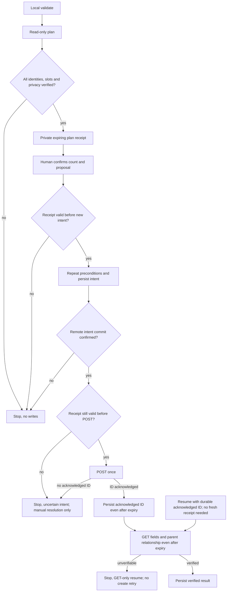

# New-profile creation: parent-only phase 1

Version: 0.4, 2026-10-27. Status: design only, not implemented or enabled. This
replaces versions 0.2 and 0.3 in full. No live API calls or test writes.

## Goal and roles

Prepare a bounded user-run addition of at most two parents to the tree owner's own
existing profile. The tree owner approves facts and their storage; the human
operator triggers the tool under that authority. An operator is not automatically
the owner. Both must be named in the private approval record. All public examples
use synthetic ZZ-prefixed names. No family data belongs in this public repository.

Phase 1 permits stable per-entry local IDs for state bookkeeping, but excludes
local-ID anchors, other relations, dates/events, profile edits, merges, photos,
email/invitations, deletion and automatic name-match reconciliation. Those features
require separate design and review, not a schema flag or force mode.

## Current source evidence and release blockers

Read without accounts or tokens:
- https://www.geni.com/platform/developer/help/api?path=profile/add-parent
  documents POST creating and returning a parent; names, gender, is_alive and
  public are writable. It does not specify union/slot selection.
- https://www.geni.com/platform/developer/help/api?path=profile/immediate-family
  documents focus and nodes, not completeness or hidden-parent behavior.
- https://www.geni.com/platform/developer/help/api?path=union
  documents partners, children and adopted/foster subsets.
- https://www.geni.com/platform/developer/help/api?path=profile
  documents profile fields including identity, names, public and is_alive.
- https://www.geni.com/platform/developer/help/api?path=user
  documents name/account_type, not the token's own profile identifier.
- https://tamurajones.net/TheGeniModel.xhtml explains historical union edges;
  it is not proof of current response completeness or mutation semantics.

The following are implementation/release blockers, not facts to fake in tests:
1. How to obtain an authoritative token-self profile ID (not name-only /user),
   normalize node versus GUID and prove equality to the declared owner.
2. How to prove the complete parent set, including hidden/inaccessible parents.
   Missing nodes, wrappers or unions are not proof that no parents exist.
3. add-parent behavior with zero, one and two existing parents; how a second
   call selects the existing union; whether gender controls a slot; adopted,
   foster and multiple-parent-union behavior. Do not assume two calls form a couple.
4. Whether public:false is honored and returned for living AND deceased profiles,
   and whether omitted/read-protected fields can be distinguished from false.

Until resolved from documentation or a separately authorized human-observed
response, production writing remains disabled. Synthetic graph/transport code can be
built offline with explicit fixture assumptions, but cannot prove vendor behavior.
No production probe by an agent. public:true is never sent, so whether the vendor
rejects it does not relax this tool's private-only policy.

## Manifest contract

schema_version: 1. Exact keys, bounded strings, no unknown API fields. Owner ref and
expect_name identify the existing root. Two or fewer entries, each relation parent
and anchor equal to that owner; per-entry local IDs identify journal entries only
and cannot be anchors; no graph sorting is needed. Each entry has stable local id,
supplied name fields, gender, explicit boolean is_alive, requested_by_owner:true and
private_storage_approved:true. Record the source and date of the owner's approvals
privately, never infer flags. The operator copies approved values; the tool
validates but never creates permission.

Unknown living status fails validation, not a living default. No guessed dates,
surnames, transliterations or maiden name. Payload permits reviewed name fields,
gender, is_alive and fixed public:false only. No data about living people appears in
public logs. Public output is fixed counts/statuses only, not even local IDs.

## Validate, plan and run

- people-validate: local-only schema checks. No token/network, no readiness claim.
- people-plan: read-only remote checks, no state mutation or Geni write. Resolve
  token-self ID, declared owner and anchor to the SAME canonical node ID, and
  verify expect_name. Name alone cannot establish owner identity. Reject merges,
  redirects/ambiguous forms, malformed/hidden family responses or other roots.
- Derive parent relationships from a complete immediate-family graph and verified
  union children/partners, not display relationships or surnames. If slot semantics
  are established, compute free slots and refuse more entries than free slots.
  Existing possible matches block for human review, never auto-skip. Multiple
  unions, unknown gender-to-slot mapping or uncertain empty slots stop the plan.
- A private local plan receipt contains creation time, expiry (15 minutes),
  manifest/schema digest, canonical owner/anchor IDs, every exact payload hash,
  state-ref head and complete parent-set fingerprint. Canonical JSON SHA256 binds
  ALL these selections. It contains no token. Store mode 0600 on the operator's
  machine; do not publish it or use a CI artifact. No future-time or expired receipt.
- Phase 1 people-plan and people-run are local-operator-only CLI commands, not
  Actions dispatches. The private receipt stays on that same operator machine;
  there is no CI artifact transfer or cross-run receipt transport. Any later
  Actions version needs a separate reviewed receipt/authentication design.
- people-run requires receipt hash, matching confirm-count and cap<=2. Recompute
  digest and independently repeat account, names, slots, graph, private repo and
  state checks immediately before every POST. Receipt changes or changed
  parent set require a new plan and approval. Expiry is checked before each new
  intent and again immediately before its POST; if expired, send no new POST.
  Always persist an already received acknowledgement and perform GET-only
  verification even after expiry. Acknowledged-ID GET-only resume does not need
  a fresh receipt. New plans incorporate acknowledged/blocked journal entries
  as known state, not unexplained new parents. Journal entries never grant
  permission for any POST. The receipt binds the initial plan-time state head.
  Run must start at that head; thereafter each verified intent/ack/result commit
  is a recorded expected descendant within this run. Unknown remote changes still
  stop. A parent verified earlier in the same run is tracked as a verified expected
  graph delta, not an unexplained change.
- Readback verifies every sent field, public:false, is_alive, gender and actual
  parent relationship. A missing field is unverifiable, not a default success.
  After an expiry stop with an unacknowledged intent, do not reuse an expired
  receipt or resume POST; use the manual uncertain-intent procedure below.
  A fresh plan cannot clear that intent or make its POST runnable.

## Durable state and git branches

Data are read from an immutable reviewed data SHA. State commits go ONLY to an
explicit dedicated state branch in a SEPARATE private state repository, never
protected main/default or any data branch. The user provisions that writable private
state ref. No fallback to another branch, admin push or force push. Verify
repository private via authenticated GitHub read.

Under exclusive local flock and a single remote-state writer, fetch state head,
require exact expected SHA and validate strict journal schema/manifest hash. The
first expected SHA is the receipt-bound plan-time state head; each later expected
SHA is the last independently fetched and confirmed commit from this run. Path must
stay within that checkout: refuse symlinks, traversal, unexpected dirty files and
mismatched manifest. Atomically replace and fsync file and parent directory. Before
POST, commit/push an intent containing payload hash and operation ordinal. Fetch
remote ref independently and require exact equality to the intended commit SHA, not
push exit 0 or an ancestor check. Non-fast-forward/concurrent changes,
protected-branch rejection, missing git identity or any durability error mean STOP
before POST. No rebase/merge/force during a run.

After POST acknowledgement, save/commit/push returned ID before verification. After
verification, persist verified state. Error, 429, timeout or kill always stops. An
intent without acknowledged ID blocks later creation, including a kill between
intent push and POST. An acknowledged ID permits GET-only verification, never
another create. No error text or credentials in commits or public output. Fixed
diagnostic phases, payload hashes, acknowledged IDs and reviewed resolutions live
only in the private state-branch journal; the private local receipt records
plan-time checks. There is no separate raw response dump or public diagnostic
artifact.

## Manual uncertain-intent procedure

There is no edit that resets an uncertain entry to not_started. The owner/operator
checks Geni manually, retaining private dated evidence and the exact manifest hash,
intent commit, operation and anchor. If a created profile is found, a separate
reviewed resolution record may bind its confirmed ID to that intent; the tool then
performs GET-only field/relationship verification. Ambiguous matches stop.

If no profile is found, absence alone does not prove the POST failed. The intent
remains blocked, even if it was likely never sent. Any later retry is a new,
separately reviewed proposal with explicit duplicate risk and a new operation ID;
phase 1 supplies no command to authorize or execute that retry. Never delete the
journal or reuse its ID to make an old create runnable. Preserve all audit history.

## Scope, token and Terms

A dedicated operator token file and explicit repo/ref/SHA selection isolate this
mode. Never switch existing source defaults or another user's token. Agents do not
mint tokens, call Geni with them, trigger workflows or use them for probes. Secure
credential custody, if separately approved, is not permission for live account use;
a claim that agents never hold any token would conflict with the optional custody
arrangement and is deliberately not made here. GitHub uses a separate
operator-provided fine-grained credential limited to the private state repository,
contents read/write only plus mandatory metadata read; no administration, workflows
or protection-bypass authority. The data repository uses a distinct read-only
credential. Neither credential is put in a receipt, journal or git history, and
agents do not use these credentials for live runs. A repository-scoped token does
not itself impose branch-only write permission. The following server-side
rulesets are mandatory, not a suggested code-only check:

- An active branch ruleset targets all branches except the exact provisioned state
  ref. It enables Restrict creations, Restrict updates and Restrict deletions. The
  operator principal has no bypass through user, team, role, app or inherited rules.
  This covers the default branch, other protected branches and new alternate refs.
- A separate active ruleset targets the exact state ref. It enables Restrict
  deletions and Block force pushes, with no bypass for the operator principal.
  Normal fast-forward state pushes remain allowed. Neither run nor recovery may
  weaken these rules or delete/recreate the state ref.
- Before planning and immediately before each new intent, verify the authenticated
  credential's principal, selected private repository and effective write scope.
  Inspect effective rules for both the exact state ref and the default ref, plus
  the complete active ruleset definitions, include/exclude conditions, inherited
  rules and bypass lists. Record ruleset IDs, updated versions and principal/role
  evidence in the private receipt. Recheck that evidence before POST; changes stop
  the run. Do not infer an empty bypass list from a response that omits it.
- The contents-only run credential may not expose complete ruleset/bypass metadata.
  Use a separate read-only audit identity with the access required to inspect it,
  never grant administration permission to the run credential. If the account plan
  lacks enforceable private-repository rulesets, the audit identity cannot inspect
  all relevant definitions or principal memberships, or the required coverage and
  non-bypass status cannot be verified, production is blocked. No test push, force
  push or deletion is used as a permissions probe.

GitHub rule meanings and availability must be checked against current documentation:
https://docs.github.com/en/repositories/configuring-branches-and-merges-in-your-repository/managing-rulesets/available-rules-for-rulesets
and
https://docs.github.com/repositories/configuring-branches-and-merges-in-your-repository/managing-rulesets/about-rulesets

Never claim a branch-scoped PAT. No token in git, logs, plan receipts or artifacts.
The human operator completes OAuth and runs it. Geni's restrictions still apply; an
API endpoint or human trigger does not prove compliance. No promise that the token
is technically limited to one tree.

No automated rollback or documented delete API. The user checks available manual UI
correction/deletion options. Do not promise undo removes history or links.

## Offline test and release gates

Only synthetic ZZ-prefixed data and loopback fake servers, with the existing
production/E2E boundary. Tests cannot settle the API blockers listed above.
- Missing flags/unknown living status, extra fields/relations, >2 people,
  anchors that reference a local ID, changed schema or digest, expired/future
  receipt and wrong token owner.
- Zero/one/two parents, second-parent same-union expectations, hidden/partial
  graph, duplicate ambiguity, multiple unions and gender/slot uncertainty.
- Every sent field/private readback, missing field, node/GUID ambiguity, merged IDs.
- Intent push rejection on protected ref, remote SHA race, public repo, dirty tree,
  state symlink/traversal, manifest change and concurrent writers.
- Missing/disabled rulesets, wrong branch conditions, omitted bypass metadata,
  inherited bypass membership, changed policy evidence, non-fast-forward state
  updates and state deletion all block before a new POST.
- Kill/error at each fsync/push/POST/ack/readback boundary, 429, malformed response,
  receipt expiry before intent/POST versus after acknowledgement, acknowledged
  GET-only resume and blocked unknown intent.
- Negative/mutation tests for every permission, identity, count and no-retry guard;
  no secret/name/ID/URL/exception leakage on any path.

Both exact-head full-diff reviews, every finding resolved, green CI and separate
human Approve precede merge. Implementation PR adds schema docs, minor version,
CHANGELOG and coverage>=80%. Image build/review/digest pin and isolated workflow
wiring are separate release work. No feature enablement or run from this design.
